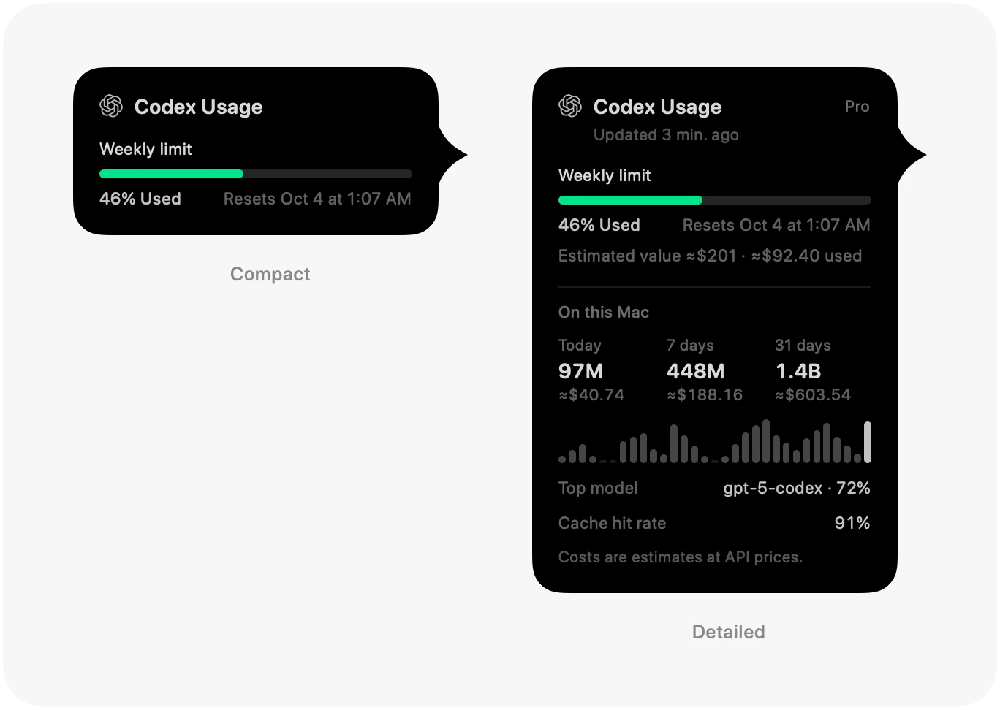
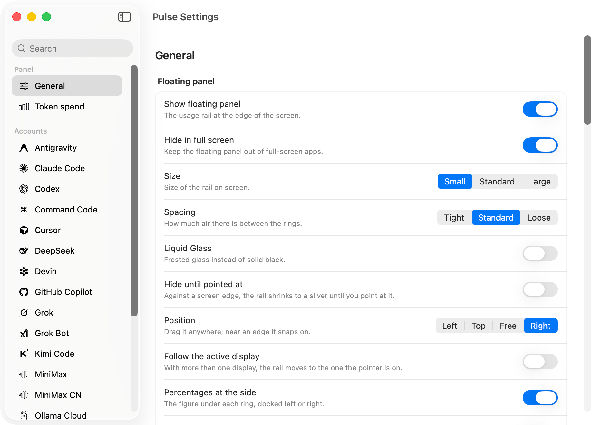
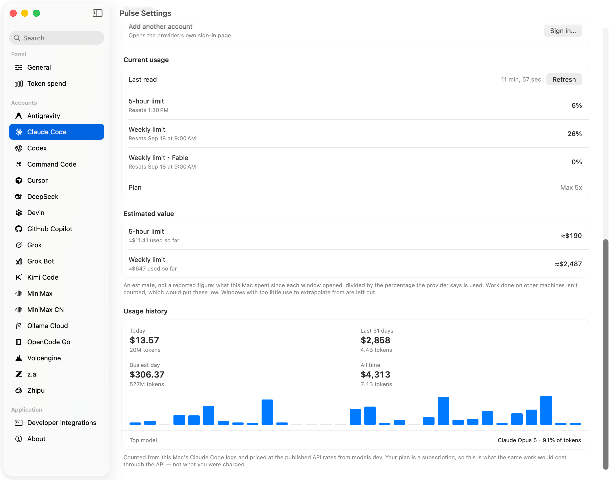
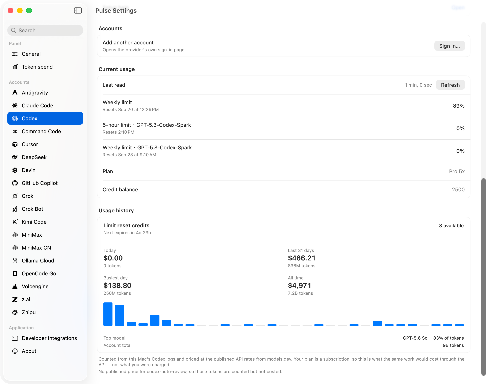
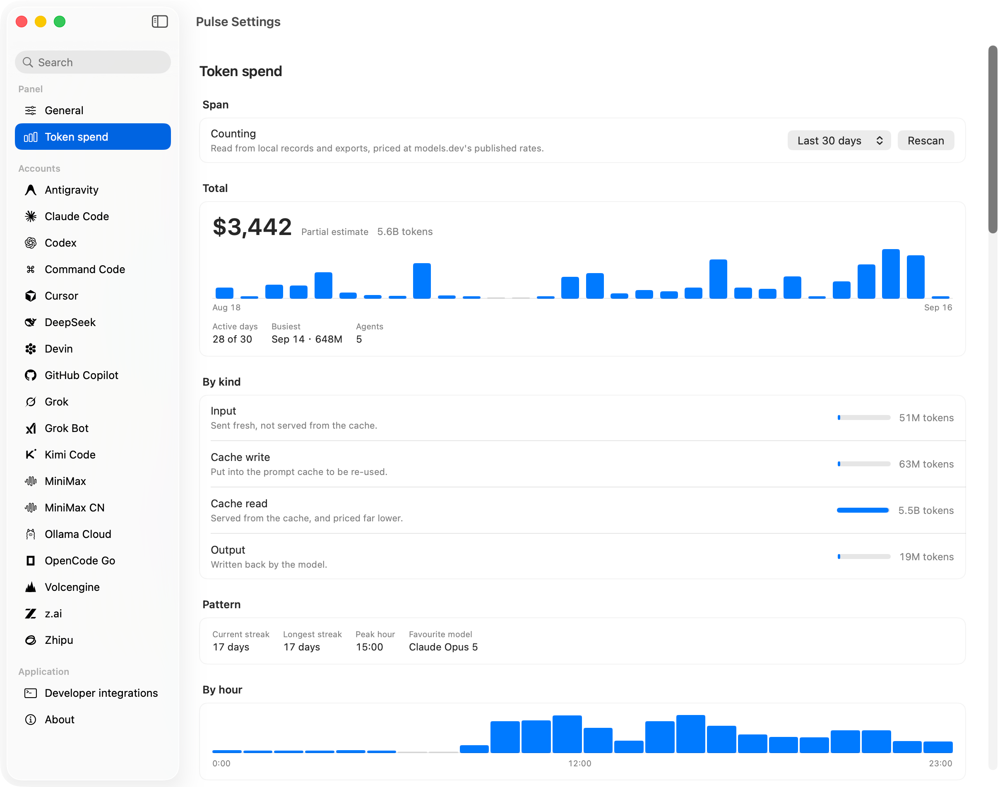
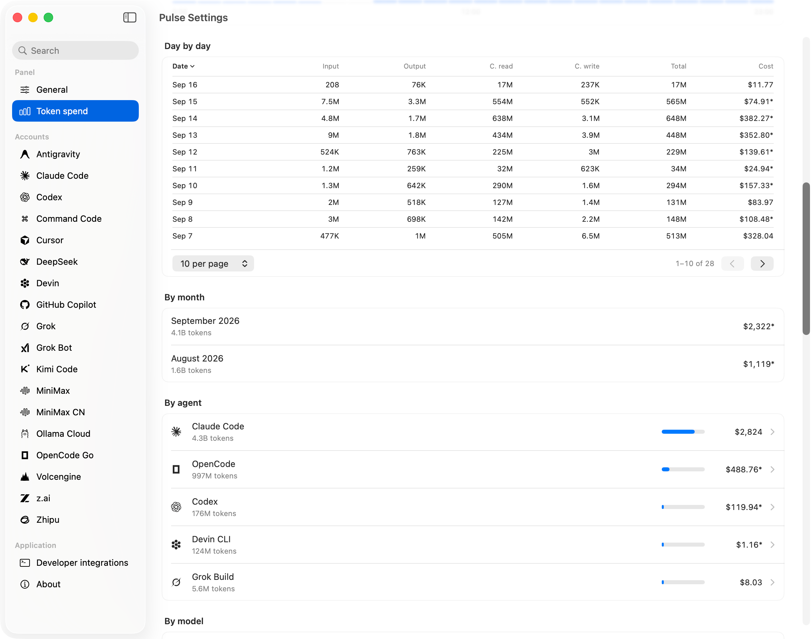
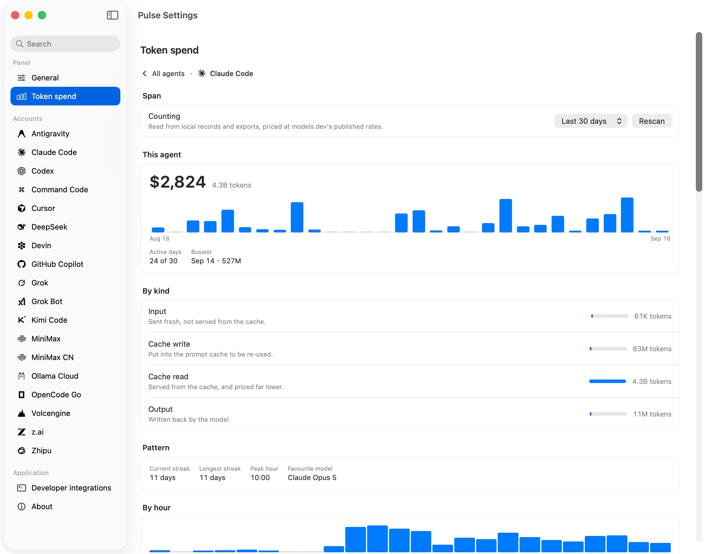
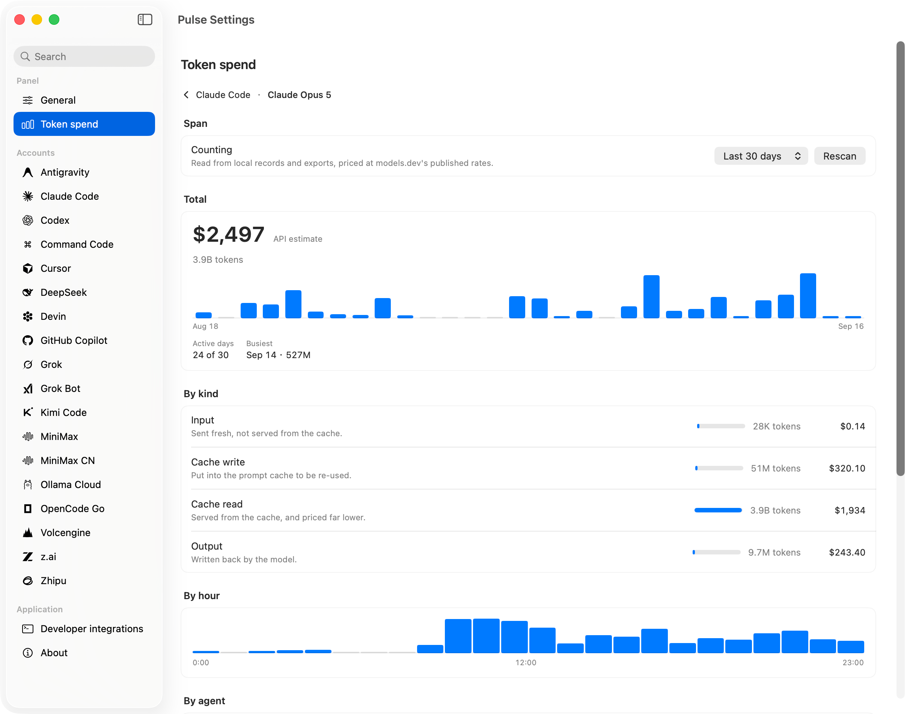

# Pulse features

Everything Pulse does, in full. The [README](../README.md) has the short version; this page is the long one, and is kept in English.

## At-a-Glance Status Rings
- **Usage-Aware Colors**: Dynamic color gradients shift from green to amber, red, and deep red when exhausted — or set custom accent colors per account.
- **Active Turn Indicator**: A subtle revolving dot indicates whether an agent is actively generating responses in real-time (Claude Code, Codex, Kiro, Zhipu and z.ai).
- **Window Clock Arc**: An optional secondary outer arc can show how much of the current rate-limit window has elapsed or remains.
- **Countdown Mode**: Toggle between showing spent quota (`75% used`) or remaining balance (`25% left`).

## Hover Details & Smart Forecasting
- **Complete Limit Breakdown**: Hover over any ring to reveal a detailed card showing every reported quota pool, reset countdowns, and current window status. Its bars can be continuous or a row of segments (**Progress bars** in Settings › Appearance).
- **Detailed Card (Optional, per account)**: Switch it on for the accounts you watch closely. The card adds the plan, when the figures were read, an estimate of what each limit is worth wherever this Mac's records can price it, and the account's recent usage — today, 7 days and 31 days of tokens, a 31-day chart, the model doing most of the work, the cache hit rate where the records sort every token by kind, and how long the prompt cache has left — for Claude Code from the tier each reply records, for Codex as the at-least-30-minutes OpenAI guarantees on GPT-5.6 and later: the card names the conversation about to lapse, and Settings lists every one — for every service Pulse has a history for: z.ai and Zhipu from their own account statistics, and Claude Code, Codex, Kimi Code, Grok, OpenCode, Cursor, Devin, Antigravity, Command Code and Copilot from this Mac's records with Token spend on.
- **Burn-Rate Forecast (Optional)**: When you turn it on, projects whether your current pace will outlast the quota window and shows an estimated time-to-exhaustion (ETA) when risk is detected. Off by default.
- **Pin Primary Window**: Pin whichever limit matters most to the ring, or let Pulse automatically track the one closest to exhaustion.

  

## Native, Fluid & Non-Intrusive
- **Flexible Edge Docking**: Dock to the left, right, top (above the menu bar) or bottom of your screen (beside the Dock), or float it anywhere, standing upright or lying across. Turn off **Snap to screen edges** and a drag only moves it — anywhere, over the menu bar and the Dock included.
- **Multi-Monitor Native**: Drag Pulse to any secondary display; it remembers screen placement and gracefully returns if disconnected. Turn on **Follow the active display** and the single rail moves itself to whichever screen your pointer is on.
- **Auto-Collapse**: Automatically folds into a razor-thin sliver when idle to eliminate distraction, glowing red only when quota runs critically low.
- **Opt-In Notifications**: You choose which ones to switch on. Get told when a limit passes 75/80/90/95%, when the provider says it is spent, when a window you were warned about comes back, and when several checks in a row fail so the panel is quietly showing older figures, and — for the services that sell prepaid credit — when the balance falls under a figure you set, and when a provider's own status page reports what its account runs on as down (any of the 44 with a page, only the ones you have switched on). Each thing is said once: a limit already past the line when you switch this on is mentioned straight away, and again when it resets or gets worse.
- **Start Usage Windows After a Reset (Optional)**: Claude Code's and Codex's windows only start at your first message after a reset. Switch this on and Pulse sends a single "hi" through the provider's own command-line tool just after each reset, within the hours you choose, so the clock starts then rather than whenever you come back. Off by default, and it is not a feature of Anthropic or OpenAI: switching it on asks you to confirm that it may be treated as getting around usage limits.
- **Spaces-Friendly**: Keeps to the Space you are working in, leaving full-screen apps to themselves.
- **Hide from Screenshots (Optional)**: Screenshot tools that support it leave the floating panel out, so their automatic window selection no longer picks it.
- **macOS Aesthetic**: Classic solid obsidian surface, a light surface for bright screens, or native **Liquid Glass** on macOS 26+.
- **Animated Marks (Optional)**: Replace a provider's logo with a small bot that reacts to what that account is doing — working, fetching, spent, or quiet. Off by default and switched on per account, with eight personalities, eighteen body shapes and a colour of your own if you want one.
- **Rail Menu & Shortcuts**: Right-click the floating rail — or the collapsed sliver; Control-click works too — for a menu with Settings and Quit. In **Settings › General › Shortcuts** you can optionally assign global shortcuts to **Open settings** and **Show or hide the panel**; both are unset until you set one.
- **Menu Bar Usage (Optional)**: Show the fullest ring — or an account you pick — beside the menu bar icon as a figure, a small ring, or its five-hour and weekly limits side by side (`5h/9%  Wk/15%`), red past the warning line. Turn on **Usage panel in the menu** and clicking it opens a dashboard: an overview of every account, and a tab per account with each limit, its reset, credits, estimated spend (with Token spend on) and a link to the provider's own usage page. Turn the floating panel off from the same menu if you only want the menu bar.
- **Six Interface Languages**: English, Simplified Chinese, Traditional Chinese, Japanese, Korean and Russian, with language-aware large-number units: K/M/B in English and Russian, and 万/亿, 萬/億, 万/億 and 만/억 in the other four respectively.

## Multi-Account & Local Ledger
- **Multi-Account Support**: Monitor multiple subscriptions for the same provider (Claude Code, Codex, Grok, Grok Bot) side-by-side with custom labels.
- **Token Spend (Settings-only)**: Off by default. Enable it on the page to scan local records; switching it off stops the scan. Reads local logs, databases and exports from a catalogue of **54 client sources**, including Gemini CLI, Cline, Roo Code, OpenClaw and GitHub Copilot. Cursor, Trae and other export sources need a prior export or capture. These are distinct from the rail's 76 quota providers; support and live-client validation vary by source. [Sources and coverage](token-spend-sources.md).
- **Estimates in Your Currency**: Estimated money — Token spend, the value of a limit, usage history, the recap — can be shown in US dollars, yuan, Hong Kong or New Taiwan dollars, yen, won or roubles (Settings › General › Currency), converted at the day's rate from [ExchangeRate-API](https://www.exchangerate-api.com) or one you type. Balances and charges a provider reports stay in its own currency.
- **Clear Usage Estimates**: Opens on the last 7 days and remembers your chosen span. Costs use published API prices, not subscription charges. Unknown prices stay unavailable, incomplete counts and coarse timing are labelled, and a source that reports no token counters says so.
- **Model Details & Charts**: Open a model for input/output/cache counts and estimated costs, daily and hourly charts where the records support them, contributions by agent, and sortable, paged detail tables. Point at a chart to read the date or hour and its token count. Unavailable daily or hourly detail is shown as unavailable, not zero.
- **Monthly and Yearly Recap**: A set of cards for any month or year, built from the same local records as Token spend and made to be shared — tokens and estimated cost against the month before, every day on a calendar, the hour you work most, the models, agents and projects behind it, your streak, and, if you type in what you pay each month, how many times over the subscription paid for itself. Save, copy or share each card as an image, in any of the six languages; project names can be hidden with one switch. Open it from the Token spend pane; an optional notification on the 1st says last month's is ready.
- **Seventy-six Providers**: Claude Code, Codex, Kiro, Antigravity, Cursor, GitHub Copilot, Grok, Grok Bot, OpenCode Go, Kimi Code, Ollama Cloud, z.ai, Zhipu, MiniMax (intl. and mainland), Volcengine, Command Code, DeepSeek, Devin, Xiaomi Coding Plan, sub2api, New API, V2EX, Qoder, and StepFun. Also Abacus AI, Aixy, Alibaba Coding Plan, Alibaba Token Plan, Amp, Atlas Cloud, Augment Code, Bifrost, Chutes, ClawRouter, ClinePass, Codebuff, DeepInfra, DevPass, ElevenLabs, Factory, Gemini, GitKraken AI, Hugging Face, Hyper, IBM Bob, JetBrains AI, Kilo Code, LiteLLM, LLM API Key Proxy, LongCat, Manus, Mistral, Moonshot, Neuralwatt, Notion AI, Nous Portal, OpenAI API, Perplexity, Poe, Qwen Cloud, Raycast AI, Replicate, Sakana AI, Synthetic, T3 Chat, TypeSafe, v0, Venice, Vercel AI Gateway, Warp, Windsurf, xAI API, xKiro, Zed, ZenMux, ZoomMate.
- **Scriptable**: `Pulse --json` prints the last readings — plan, every limit, reset times, and how old the figures are — for tmux, sketchybar, Raycast, or a shell prompt. It reads the cache, so polling costs nothing.
- **Developer Integrations**: Export a Raycast extension and ready-to-configure tmux, sketchybar and shell scripts from Settings. Account links open the right pane directly. [Setup guide](integrations.md).
- **Extensions**: A small program of your own can report one account's usage — an internal quota endpoint, say — and Pulse draws it as a ring, with no fork to maintain. Nothing runs until you switch it on, and Pulse hands it no credentials. It can also report figures of its own, such as a relay's response time, shown on its card with a trend line. [How to write one](extensions.md).
- **Service Status**: 44 providers' settings show their own status page the way it draws it — each part up or down now, the page's bars where it publishes them (a day each for the last 90 days on most, OpenCode's week in three-hour slots) and the uptime it reports — only the parts that are the provider's own, read when you open the pane, every five minutes while it stays open, and on **Refresh**. A page that can't be read says why. [Which pages](providers/README.md#service-status).
- **Connection Diagnostics**: See the actual reading source, cache use, latest check and fallback outcomes, and the servers' own replies to that check — status, address and body, credentials hidden. Contextual actions help reconnect, sign in again or fix credentials; copy a diagnostic report without account details or secrets.
- **Privacy First**: Pulse runs on your Mac under your own provider logins. It makes five kinds of connection and they are all listed here: the providers you already use, their public status pages for Service status and its notification, [models.dev](https://models.dev) for public model prices in the token-spend pane, [ExchangeRate-API](https://www.exchangerate-api.com) for the day's exchange rate while estimates are shown in a currency other than the dollar, and GitHub/Sparkle for app updates. Provider requests, status pages, sign-in exchanges, models.dev and the exchange rate use the proxy chosen under Settings › Network and refresh; supported helper processes receive the same custom proxy, or none with No Proxy. Sparkle update checks always follow macOS system proxy settings.

  

  
  &nbsp;&nbsp;
  

  
  &nbsp;&nbsp;
  

  
  &nbsp;&nbsp;
  

## Privacy and security

Pulse is designed with strict local-first security principles:
- **No Pulse backend**: Your Mac talks to the providers you already use, under your own logins. It also reads the providers' public status pages for Service status (no login), fetches public model prices from [models.dev](https://models.dev) for the token-spend pane, fetches the day's exchange rate from [ExchangeRate-API](https://www.exchangerate-api.com) only while estimates are shown in a currency other than the dollar, and checks GitHub/Sparkle for app updates. Provider requests, status pages, sign-in exchanges, models.dev and the exchange rate use the proxy chosen under Settings › Network and refresh; supported helper processes receive the same custom proxy, or none with No Proxy. Sparkle update checks always follow macOS system proxy settings.
- **Local Credentials**: Reads credentials already stored locally by your development tools (`~/.claude`, `~/.codex`, Cursor storage, etc.) where that is how the product works; some providers need a key or sign-in you enter in Settings.
- **Encrypted Local Storage**: Manually entered API keys and session tokens are encrypted and saved strictly in Pulse's local application directory with owner-only permissions.
- **Server Replies Stay in Memory**: The replies Connection diagnostics shows are kept only until the next check and never written to disk; no request header is kept, and credential-like values in a reply are hidden.
- **Local Usage Records**: Pulse reads transcripts, databases and exports to obtain token counts and session metadata such as titles and working directories. These records may contain conversation text; processing stays on your Mac and the records stay with it. Pulse reads those records and nothing else.
