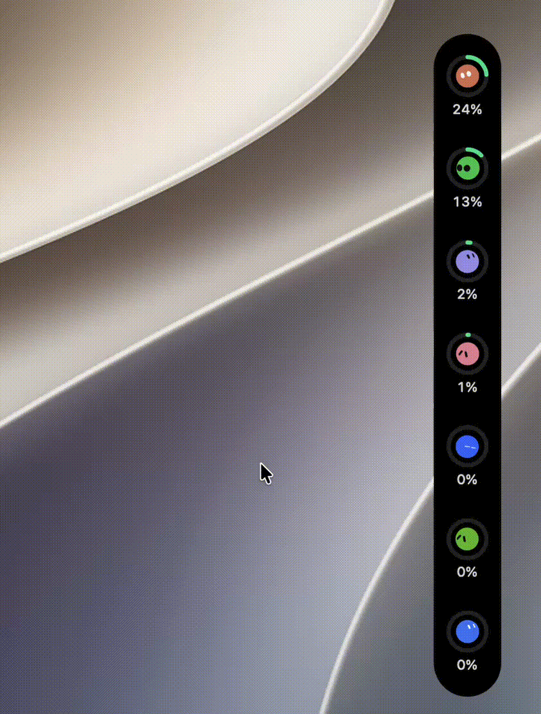

# Rings and surface

The panel's surface (solid, light, Liquid Glass), what ring colour means, the arcs a ring can carry, and the animated marks. Input and hit testing: [input.md](input.md).

## Light panel

Light is a case of `AppSettings.panelAppearance` (and of Auto when the Mac is light), not a second switch (#74). The solid surface is drawn light (`PanelLight.fill`, grey 0.97 with a 0.12 black hairline so it keeps an edge on a white page) with dark content. The hairline is drawn **inside** the outline: the window is exactly card + rail wide, so the free rail's far side and the card's far side lie on the window's edge, and a line drawn outside was cut off there. It strokes the *normalized* path (the card's tail is a separate, overlapping subpath) and leaves out `PanelSurface.screenEdge` — the docked side, or the notch berth's top — where it would be a grey line along the display's own edge. It is a colour scheme, not a second set of views: `FloatingUsagePanelContent.panelScheme` pins `.light`, `PanelSurface` picks its fill off `\.colorScheme`, and content already drawn in `.primary` follows.

- **Solid surface only, notch included.** Glass stays dark until the Transparency slider passes three quarters, for the reason below. At a notch the berth is light too — the reader chose light, and a surface that silently turns black when docked there read as a bug. The notch fillet is the housing's own radius, and the berth is the free rail's width, not a second size.
- **The usage colours have light twins.** `pulseGood` / `pulseCaution` are about 1.5:1 on a light surface — no reading. Each `Color.pulse*` — including Gradient's peak and Quiet's greys — is a dynamic `NSColor` that resolves a deeper twin under an aqua appearance, ≥ 3:1 on `PanelLight.fill` (`UsageTintTests` pins both the switch and the ratio). The same twins appear in the menu where macOS draws it light. A colour chosen per account (`RingTint`) is the reader's and is not adjusted.

## Liquid Glass

Optional, **off by default** (`AppSettings.panelAppearance == .glass`, `PanelSurface`). Dark (flat black) stays the default because a solid rail is legible over anything.

`AppSettings.panelAppearance` is **dark / light / system / glass** — one setting. Glass used to be a separate toggle that silently overrode Light. Light exists because a black bar parked on a page of work all day is a hole in the page — not pure white (that vanishes on a white page, and the panel has no window shadow), a hairline on the light fill is the edge. Auto follows the Mac.

- **When glass is on, dim it, and let the text follow the slider.** With the active-appearance gate open (below) `.clear` glass is nearly transparent: white over a white page, black over a terminal. So the glass carries `PanelGlass.dim` — black up to 0.6, set by the reader's **Transparency** slider (`AppSettings.glassTransparency`, default 0.5 → 0.3), handed down as `\.glassTransparency`. Up to `PanelGlass.inkTurns` (0.5) the panel stays dark. Past that, `panelInk` turns the text from white toward black, and past `PanelGlass.schemeTurns` (0.75) `panelScheme` follows into light so hairlines, tracks and the usage colours stay readable. The slider's caption says black text is hard to read over dark windows. Dark, light, and auto still apply when glass is off, through `panelAppearance`. The scheme is `.environment(\.colorScheme, …)`, not `preferredColorScheme` (window-wide).
- Do **not** take the surface out of hit testing. `allowsHitTesting(false)` is what stopped gap-dragging. The window takes the drag in `sendEvent` before any view sees the event. [input.md](input.md)
- **Liquid, not frosted, depends on `FloatingPanel` overriding the private `_hasActiveAppearanceIgnoringKeyFocus` to return `true`.** Glass in an inactive window is drawn as a flat blur with no lensing, and this panel is always inactive (not key-eligible; and once Pulse has been active even once, all its windows go inactive when another app takes over). Do not "fix" it by making the panel key-eligible instead: that only holds until the first deactivation and puts focus at risk. If macOS stops asking the selector, the glass goes back to frosted and nothing else breaks. [../decisions/liquid-glass.md](../decisions/liquid-glass.md)
- Use `Glass.clear`, not `.regular`. `.regular` was measured (historical) as opaque milky white in a transparent panel. Needs macOS 26; `#available` with a vibrant blur behind it.

- **Glass needs a pixel under it** (`PanelGlass.claim`, black 0.01). The glass and its tint are composited by the system, not drawn into the window, so where only glass lies the window's own pixels are empty and the window server hands the press to whatever is behind — `sendEvent` never sees it. Reported on the docked rail (#68): rings draggable, glass between them not. Verified by real input on the docked rail after the fill went in. Do not remove it, and do not take it to zero.

[../decisions/liquid-glass.md](../decisions/liquid-glass.md)

## Colour and spent

Colour means **usage**, not identity. One setting owns the whole colour language: `AppSettings.ringColourScheme` (`RingColourScheme`, default Red alert). 1.2.1's spent-only picker (Emphasize / Follow usage / Quiet) only overrode the spent hue, so Quiet still went red at 98% used through the green→amber→red ladder. The scheme is the vocabulary; a global threshold plus a spent-only tweak is not. `Provider` carries no accent; the icon is the brand. Brand-coloured rings read as a warning (Claude’s orange at 3% used).

Three schemes, one value on the environment (`ringColourScheme`) so every ring, bar and figure agrees. `UsageTint.color(for:isExhausted:warningAt:scheme:)` and `UsageWindow.tint(warningAt:scheme:)` take both with **no default** — a default is how one ring comes to disagree with the one beside it. The environment is set once in `FloatingUsagePanelContent`.

- **Red alert** — the default, and the **only** scheme that may draw red. Green below `warningThreshold`, red at or above it, spent deep red (`pulseExhausted`). No amber step. `Turn red at` (`WarningThreshold`, 60–90%, default 75) is nested under Red alert and Quiet. It reaches the panel through `EnvironmentValues.usageWarningThreshold`, set once in `FloatingUsagePanelContent`.
- **Gradient** — green → yellow/amber → deeper amber/orange by usage. `warningThreshold` is the yellow→orange step internally and is never shown as a red control. **Never red**, including when spent, exhausted, or locked.
- **Quiet** — the same green band Red alert uses below the threshold; muted grey at or above it, and when spent. **Never red, never amber.** Not a grey wash of the whole rail — 93% remaining stays green; 2% remaining and a spent limit go grey. The 1.2.2 full-greyscale reading was a misread; [quiet-is-not-greyscale.md](../decisions/quiet-is-not-greyscale.md).

`warningThreshold` is not a layout input, so it does not belong in `PanelMetrics`. Every offered figure sits above `UsageTint.cautionThreshold` (0.5), which is Gradient's green→yellow step.

Per-account `RingTint` is opt-in. Under Red alert, spent red still wins over a chosen tint (`UsageRingView.isSpent` from the **provider**, not from the fraction — a lock can happen well short of 100%). Under Gradient and Quiet the scheme wins over alarm red; a chosen tint is kept, including when spent. System colour well, stored as hex, converted through **sRGB**. No opacity (translucent reads as “no reading”).

**Collapsed alert colour.** `FloatingUsagePanelContent.alertTint` finds the worst headline window across the rail and, past `warningThreshold` or exhausted, hands its `UsageTint` colour to `UsageDockView.alert`. An ordinary `PanelSurface` applies it only while collapsed (`isExpanded ? nil : alert`; expanded, the rings already say it). A physical notch has no collapsed surface, so `NotchAlertShape` draws the colour as a 2pt edge directly below the housing. `AppSettings.dockShowsAlertColor` (on by default) gates both inside `alertTint`, so off is the same `nil` an all-green rail produces. It exists because several accounts past the threshold otherwise leave a line coloured for as long as it is watched, which reads as a stuck pixel rather than a warning. [settings.md](settings.md)

**Countdown** (`showsRemaining`): the arc follows the figure; colour still means closeness to the limit. No reading → empty track either way; spent fills the ring. Do not invert `nil` into a full "100% left" circle. [../refresh-and-data.md](../refresh-and-data.md)

## Hover halo

The pointed-at halo hangs on the **progress arc**, not the ring view, and its inward half is **masked**. Not a `.shadow` on the composed view (it draws behind the icon and antialiased edges leak tint), not an opaque disc (invisible on black, a white coin on glass); a mask has no colour to get wrong. Measurements: [../decisions/liquid-glass.md](../decisions/liquid-glass.md).

## Window-clock arc

`showsWindowClock`, default off. Drawn **outside** the usage ring (inside belongs to the activity mark), neutral and low opacity, not a second hue. `windowClockDirection` chooses filling with elapsed time (the default, so existing installs do not reverse) or emptying with time remaining. Either direction needs both the provider-reported reset and duration (`reportsLength` must be true); with either missing it is nil. Applied as an overlay **after** `.frame(width: diameter…)`, never as a ZStack child (a wider child grew the usage ring). Own 60s ticker, not the usage loop.

## Second ring

`showsSecondRing`, default off. `ProviderUsage.secondWindow(preferring:)` returns **the fullest limit in the ring's own model group**, else the fullest of everything else. Nil where the provider reports one limit: an empty second ring reads as a limit at zero, or as a fault.

- **The group comes first because a provider can report independent budgets.** Antigravity reports a five-hour and a weekly for `Gemini` and the same pair for `Claude and GPT`; pairing a Gemini weekly with a Claude five-hour would put two unrelated pools on one mark. Claude Code's five-hour and weekly are unscoped, so they pair with each other and the model-scoped weekly stays on the card. "Fullest" rather than "the weekly one" needs no per-provider table and still works when the ring is pinned. `max(by:)` keeps the first of equals, so untouched windows stay in the provider's order between passes.
- **Inside, not outside.** Outside is the clock arc's, and the limit that matters most stays the outer, bigger, thicker ring, so nothing moves for anyone who leaves this off. Same colour language as the first ring; size and weight tell them apart. Spent fills it, whichever way it counts.
- **Geometry lives in `DockLayout.secondRing…`, not in `PanelMetrics`**: nothing outside the ring changes size. At standard scale the band between the icon disc and the ring's inner edge is 6pt and the activity mark rides its middle; with the second ring on, the mark moves in against the disc and the disc gives up 2pt a side. The ring, the rail's width and the ring centres are unchanged.
- **The percent label follows the outer limit only.** Two figures there would change `DockLayout.percentTextWidth`, a budget the whole rail is measured from.

## One ring per model group

`AppSettings.splitAccounts`, per account, default off, offered only where `Provider.splitsByModelGroup` is true — Antigravity alone, whose plan reports a Gemini allowance and a Claude-and-GPT one as two `scope`s of one login. One ring could only show the busier. Off by default because a second ring costs a slot, and docked, the rail is the whole panel.

- **The rail is slots, not accounts.** `RailSlot.rail(for:isSplit:groups:)` is the one place the order is decided; the panel's `entries` and `PanelHitArea.slot(at:)` both go through it, so a ring is never drawn at one position and refreshed from another. A slot is an account plus an optional group; `id` is `account@group`.
- **A limit never disappears into the split.** `modelGroups(of:)` is all-or-nothing: a reading that mixes scoped and unscoped windows yields no groups. More groups than `modelGroupCount` leaves the account whole rather than dropping the extra group — one ring showing the busiest of three is better than a limit nobody can see.
- **One slot until a reading carries more than one group**: one ring that becomes two beats two empty ones that may never fill. Groups keep the provider's reported order (what Antigravity's own screen shows).
- **Both rings are the same account**: icon, tint, key, refresh. Clicking either refreshes the login. They differ in windows (`windows.filter { $0.scope == group }`) and title, which appends the group so VoiceOver and the card do not repeat themselves.
- **The budget moves with it.** `AppSettings.railSlotCount` counts a split account as `provider.modelGroupCount` (a fixed 2, so the rail does not resize when a reading is one group short) and feeds `PanelMetrics.makeRoom(for:)`.

## What may not be animated

The rail's `railTop` / `railLeading` offsets track the pointer, so they sit **outside** `.animation(_:value:)`, applied after the card's reveal. Inside the card's `value: selectedSlot` spring, the first frame of a drag closed the card and sprang the rail's position too, so the panel slid away from the hand dragging it.

## Activity mark

White arc on the band between the icon disc and the usage stroke — **or just outside the disc while the second ring is on**. Core Animation, not `TimelineView`. Reset `spinning` on disappear. Not drawn on a ring showing an animated mark (below). [../refresh-and-data.md](../refresh-and-data.md)

**`AppSettings.animatesRingActivity`** (on by default) is the one switch over this arc and the refresh mark drawn over the usage arc during a fetch. `UsageRingView.isBusy` / `isRefreshing` track the facts either way; off only withholds the cue — no travelling arc, no refresh sweep, no dimming of the usage arc while it fetches. [settings.md](settings.md)

## Animated marks

  

`AppSettings.botMarks`, **per account**, default off, switched on in that account's provider pane. It reaches the ring through `RailEntry.showsBotMark`, as the chosen tint does, not through the environment. A logo says which of seventy-seven products a ring is; a mark trades that for motion, worth it only on the rings somebody watches work. Provenance, rights, and why the motion follows the upstream: [../decisions/bot-mark-geometry.md](../decisions/bot-mark-geometry.md). Regenerate the data with [`Scripts/extract-bot-data.py`](../../Scripts/extract-bot-data.py).

**It replaces the activity arc on that ring only**: `isBusy` draws the bot's `working` state and no arc. Rings showing a logo keep the arc.

### Personas and scenes

**Eight personas** (`BotMarkPersona`, `BotMarkChoreography`), each with its own idle signature, three-beat everyday scene, four-beat work scene, refresh and attention responses, and finish acknowledgement; `tempo`, `motionScale`, `gazeScale` and `eyeScale` accent those scenes. **A persona changes how a mood is expressed, never the reading**: task effects need work or fetching, a spent limit gets a downcast or alarmed response, a missing reading an uncertain one.

- **Automatic** (the default) deals personas **by position on the rail**, so neighbours differ; eight rings pass before one repeats. A per-account choice in the provider pane (`AppSettings.botPersonas`, absent = automatic) wins; a stored persona that no longer parses reads as automatic.
- **The body is the reader's, round by default** (`BotMarkBody`, `AppSettings.botShapes`, absent = `blob`). All eighteen upstream shapes are available whatever the persona; a scene may morph into an effect but never changes the resting silhouette.
- **A scene plays every beat in order.** `BotMarkRoutine` stores each state with its duration (its cached state/hold tables are shared immutable data); `BotMarkProgramme.forMood` selects the scene and requests sequential playback. The engine enters at the signature pose and completes the scene before looping, with a small random hold within each beat's bounds. Random selection skipped characteristic actions and made differently ordered lists identical; raw engine callers can still request it.

The arrows are the actual sequence. Idle beats generally last 1.2–6.5s (sleepy rests longer), work beats 1.8–6s; `BotMarkChoreography.swift` is authoritative for each hold. Every persona has a different **set** of states in every mood.

| Persona | Everyday idle | Working | Refresh | Pointer attention | Work finished |
|---|---|---|---|---|---|
| Calm / 沉稳 | idle → listening → shy | working → thinking → searching → writing | receiving → listening | listening → idle | happy |
| Eager / 热切 | happy → curious → playful | excited → spawning → working → radar | spawning → radar → receiving | happy → curious | excited |
| Steady / 踏实 | humming → listening → idle | working → writing → searching → orbit | loading → orbit | listening → humming | humming |
| Curious / 好奇 | curious → suspicious → surprised | searching → radar → working → thinking | radar → searching → thinking | curious → listening | surprised |
| Sleepy / 迟缓 | shy → idle → happy | working → thinking → searching → receiving | listening → loading | shy → listening | shy |
| Playful / 顽皮 | playful → bouncing → laughing | excited → orbit → searching → writing | orbit → receiving | playful → surprised | laughing |
| Stoic / 冷面 | suspicious → listening → idle | searching → radar → working → loading | searching → thinking | suspicious → listening | proud |
| Proud / 得意 | proud → happy → laughing | excited → orbit → working → spawning | thinking → loading → radar | proud → happy | playful |

- **Everyday and working vocabularies are disjoint across the whole cast.** Humming, playful bouncing, curious/listening and proud/suspicious poses are everyday only; work alternates working/searching/excited faces with task morphs. An idle character therefore never looks like another persona's work; changing tempo alone did not distinguish mixed pools.
- **Spent and unavailable responses are authored per persona** (eager/startled and stoic/annoyed differ from calm/downcast and proud/embarrassed). None includes a carefree happy scene, a work effect or a reset celebration.
- **Only the sleepy persona (「迟缓」) may doze.** Its awake scene is `shy → idle → happy`, with slower tempo and smaller motion and gaze scales. It may add `drowsy` at night or in its spent/unavailable responses, alternating with sad/confused rather than settling into a sleeping face. No other persona receives drowsy, sleeping, powering-down or bored. This follows the resolved persona, chosen or dealt.
- **29 of the 39 catalogue states are reachable**, including orbiting dots, radar waves, loading ribbons, incoming dots, the playful bouncing ball and the spent-limit exclamation. Idle keeps the face most of the time; only playful briefly morphs into the ball. Sending/uploading/dictating/dragging/notification badges need their event, and the determinate `progress` fill would imply progress Pulse did not measure. Sleeping, waking, powering-down and bored are in no production scene.
- **Short scenes get their full eye vocabulary.** Returning to a state advances through its expression pool instead of restarting it; first entry keeps the characteristic expression. A 2s pose never reached the 9–16s expression timer, which left most of the artwork unreachable.

### Moods and events

**Five moods, and no sixth** (`BotMarkMood`), resolved from existing facts: busy → working scene, refreshing → refresh scene, spent → spent response, no reading → unavailable response, otherwise idle. Busy outranks the others. Local work detection comes from Claude Code and Codex transcripts; other providers get everyday scenes without pretending that a quota change proves work. **Nothing here reads the warning threshold**: the ring already says how close the limit is.

- **Pointer attention is personal, and interrupts idle only.** An idle mark switches to its persona's attention scene and follows the pointer; a working mark keeps working; a spent or unavailable one keeps its response rather than greeting the reader as if the account were fine.
- **`angry` joins the playlist out of hours and only then** (`BotMarkHours`, outside 09:00–21:00 on weekdays; weekends count as out of hours). The hours are a guess — the app has no calendar — kept in one file and outside the mood table so they cannot pass for a reading.
- **Night is separate from overtime.** `BotMarkHours.isNight` is **23:00–08:00 local time**, every day; a Saturday afternoon does not make idle marks drowsy.
- **Quiet only adds an accent to sleepy.** Twenty minutes with nothing written by the watched CLIs (`AgentActivityMonitor.lastWrite`; **nil is not quiet**) permits a `drowsy` beat at night for sleepy alone: its three awake beats total **14–19 seconds**, then **2–3 seconds** of drowsy, then the scene restarts awake. There is no daytime boredom accent, and CLI silence is not evidence that other providers are idle. `BotMarkRestTests` checks the restriction across every mood, quiet/hover condition, weekday/weekend and day/night ([../testing.md](../testing.md)). Historical probe (2026-09-19): with work's 2.5–4.5s holds and `isOvertime` as night, ordinary personas were drowsy about half of a quiet Saturday night, and reweighting alone was not enough.
- **Two one-shots** (`BotMarkEvent`), both facts Pulse witnessed. A limit turnover (`ResetWatch`, the same unambiguous rule as notifications) plays the full 6.4s `celebrate` — nine turns and ribbons. A turn that just ended (`AgentActivityMonitor.finishedAt`) plays **2.6 seconds** of the persona's acknowledgement; the monitor fences scans that outlive it, so stopping monitoring is not a fabricated finish. An event interrupts the scene, plays once and returns; it is not replayed while its fact holds, and a reset outranks a finish. **Its window must close on time** — 20s for a reset, 6s for a finish — because the engine re-arms only on nil; `FloatingUsagePanelView` looks again each second while an event shows. Left set, a remounted mark replayed it and the next real finish played nothing.
- **Ribbons are a busy/event cue, at every size** (including 25pt). `BotMarkProgramme.configuration` enables particles only for working, fetching, or a one-shot actually playing; idle and attention spins draw none. The engine marks the active event interval, so an event flag still true after its 2.6/6.4s must not re-enable them, and live particles and pending emissions are cleared when busy/event playback ends. The Reduce Motion master switch wins.

### Gaze and pointer

- **The eyes follow the real pointer.** `PanelPointerWatcher` samples a position (`.onHover` does not work on this window, [input.md](input.md)); it is handed down the rail and each mark measures it relative to itself through a `GeometryReader` in the panel's named coordinate space, divided by four radii (upstream: two) so the ring under the cursor looks hardest and its neighbours part of the way. Nil, when the pointer leaves the panel, returns each mark to its own wandering gaze.
- **The pointer outranks the mark's habits.** The expression's built-in glance reaches 76 units and the edge lean 7, against a pointer worth 22; on a right-docked rail they pulled a mark to stare away from the cursor. Upstream damps the state's glance to a fifth while the pointer is on the panel; the lean and the artwork's glance give way in the same measure — the artwork's by subtracting most, not all, of the eye pair's own offset, so a `sad` mark still looks sad. `BotMarkTests` checks every persona, facing the screen, with the pointer on the far side.
- **It is a look, not a switch** (`BotMarkEngine.attention`). Each mark notices after its own random 50–250ms, then a critically damped spring hands the gaze over in about 0.4s; leaving eases back with no delay. The largest one-frame eye step on arrival went from 30–60 units to 1–5. `BotMarkAttentionTests` holds it as the median of twenty-one runs, with playful left out (its own gestures dart the eyes as far).
- **The mark faces away from the screen edge** (`BotMarkGaze`): docked right looks left, docked left looks right, a top rail looks ahead. Two mechanisms, because neither works alone: a standing lean of seven units added to (not replacing) the wandering gaze, and *reflecting* the gaze for the left-facing case. An expression's eye pair is itself off-centre (from 44 units left of the head's centre to 76 right across the twenty-five), so turning also reflects the pair about the head, swapped left for right, blended point by point. Not reflected: the pointer (a real place on screen) and a `notifying` mark's glance at its badge (fixed on the body).
- **It turns the gaze, not the body** (`BotMarkEngine.facing`, spring frequency 9 / damping 0.85, about a third of a second, so a change of edge reads as a decision). Mirroring the whole draw transform flipped the body over like a card; `BotMarkTests` asserts the body's horizontal scale stays positive and it travels no further across a turn than at rest. The **first** frame snaps to its target, so marks do not swing on launch. The rail keeps its views across an edge change — `AnyLayout` and a `ForEach` keyed by account id, `NSHostingView` built once — which is what lets the spring see the change.
- **Measured, not eyeballed.** The lean alone (1.2.0) left a right-hand rail averaging right of centre for four of eight personas; its test had switched off the autonomous gaze. `BotMarkTests` now runs every persona in both moods for ten minutes each, everything on, and asserts the mean is left of centre.
- **No eye limit of Pulse's own.** An eye is bounded only by the upstream's clamp to the body's silhouette and may sit against the edge ([../decisions/bot-mark-geometry.md](../decisions/bot-mark-geometry.md#the-originals-motion-is-not-trimmed)).

### Motion

- **Working must look like working**, since the mark replaces the activity arc. Rotation cannot: its 5 rad/s spring low-passes a 1.6Hz signal (a 2.4× target moved the swing from 1.1° only to 2.6°). **Squash carries a pulse** (`squashScale`, ×3 for working; measured 3.7% peak-to-peak height against idle's 1.3%), **clamped to 0.9…1.12** — a guard, not tuning: ×10 read as the mark resizing, and the same multiplier collapsed `excited` to a fifth of its height. **Tempo halves** (`tempoEmphasis`): blinks and glances twice as often, and the spin every 3–4.5s instead of 6–9. The spin throws **ribbons** (measured on 158 of 720 frames over twelve seconds). Neither emphasis touches translation, which stays the upstream's.
- **A change of state never teleports the body** (`BotMarkEngine.render`: `drawn`, `carry…`). Celebrate's turns, a gesture's shake and a morph's pose are drawn directly, so a switch mid-motion jumped up to 144° or 108 units in one 30fps frame (ordinary motion peaks near 15). The difference between the last drawn frame and the new state's first is handed to critically damped springs (frequency 12) that ease it to zero; angles unwind the short way. The springs must be **built at the difference with a target of zero** — `BotMarkSpring(value)` targets its own value, which left the carry standing until the body left the canvas. `BotMarkContinuityTests` bounds the worst frame at 30 units / 30°.
- **The drawn position is not bounded**, as upstream: the viewBox leaves ~15 units around the body, `drowsy` nods 25 and a bounce throws the body 48, so the head can be clipped for a moment.
- **Reduce Motion** draws the scene's first signature pose as a settled still, not a frozen first frame, so the mood stays legible. It is solved **outside** the draw closure and memoised (a still is three seconds of simulated animation, and a draw happens on every pointer move); the key includes eye/gaze scales and canvas width as well as body and motion settings. It waits out a blink by asking whether one is *in flight*, not by an eyelid threshold: `drowsy` rests at 0.34 and never blinks.
- **30fps** (`TimelineView(.animation(minimumInterval:))`), not the display's rate: invisible at ring size and cheaper — settled, seven animated rings cost ~15% of a core against ~19% at display rate, over a ~10% baseline with none. `TimelineView` does tick on this panel (measured once on a real docked rail: three captures 0.45s apart all differed); that is one measurement on one machine.
- **Paused while the rail is collapsed** (`EnvironmentValues.botMarksPaused`, set by `UsageDockView` on its rings; `TimelineView(.animation(minimumInterval: 1/30, paused:))`). Collapsed, the rings stay in the tree at opacity 0 so nothing moves as the rail opens, and the timeline went on ticking behind the sliver: every mark redrawn 30 times a second and the whole panel laid out with them, for nobody. Measured on an M5, five marks, rail shut: 6–10% of a core before, under 2% after. The last frame stays drawn, so the fade-out is of what was there; the engine clamps a frame to 100ms as upstream does, so it resumes where it was. **Not a host per mark.** Tried 2026-10-14: each animated mark in its own `NSHostingView`, so a tick would not update the panel's. Unchanged on screen, but the process went from ~10% to ~22% of a core on an M5 with the rail out (five marks, twice each). Expanded, the busy main thread is SwiftUI's per-frame update and render; the mark's own maths is ~4% of it, so every extra host added a copy of the fixed cost rather than removing one. **Nor one display-link clock for all marks.** Tried the same day: a `CADisplayLink` at 30fps (`NSView.displayLink`) writing an `@Observable` time the marks read, after a small harness on the same M5 had a `TimelineView` laying the host out at the display's 120Hz and this cutting cycles by 35–45%. In Pulse the main thread's own samples fell, but the process did not: 5.47 / 8.60 / 14.07% against 5.50 / 7.50 / 9.27% for the timeline, alternating 30-second runs with the rail out. The harness's saving did not carry over; measure in Pulse, not in a harness.

### Size

`botScale` 1.4 against `iconScale` 0.8, measured against the **ring's inner edge**, not the disc: the canvas takes the full 28pt inside a standard 36pt ring, so the body is about 25pt with 1.6pt of clearance from the stroke. It needs that much: the 259-unit viewBox around a 229-unit body leaves margin for bob, lean and squash, and a face needs room for two eyes. It is wider than the 20pt disc on purpose (a near-black disc on a near-black rail reads as a shadow; the ring is the visible edge) but scales *with* it, so the 2pt a side the disc gives up to the second ring takes the mark too. Any bigger and the ring's stroke or its 4pt gap, both layout budgets, has to give.

### Colour

**Colour is identity, not status.** `BotMarkTint.brand` is the provider's own colour where it has one, lifted toward white below a luminance floor of 0.42 (several brands are black and would be a hole in the disc), with the eyes flipping to keep contrast. Kimi's is **`#7AA5FF`**, lighter than the former `#2F6BFF`, to keep its face bright at ring size. This is the one place brand colour is allowed on the panel; the ring beside it still means only how close the limit is (see the comment on `UsageWindow.tint(warningAt:)`).

**Historical local frame probe (2026-09-19):** the old idle playlist used work's equal 2.5–4.5s holds, and its night predicate was `isOvertime`, including the whole weekend. In a 120s quiet Saturday-night simulation, ordinary personas spent roughly 49–51% of their time in `drowsy`; sleepy spent 100% in either `bored` or `drowsy`, with its eyelid below 0.7 on about 95% of frames. A first timing-only fix reduced rest to roughly 12–13%, but the user still found sleep too frequent. The current rule removes these states for every persona except sleepy instead of only reducing their weight. `BotMarkRestTests` now checks every mood, quiet/hover condition, weekday/weekend and day/night combination for that restriction, alongside the frame budget for sleepy's remaining accent. These are engine-frame checks, not real-input verification.

**Two one-shots** (`BotMarkEvent`), both facts Pulse witnessed. A limit turnover plays the full 6.4s `celebrate` — nine turns and ribbons — from `ResetWatch`, using the same unambiguous turnover rule as notifications. A turn that just ended plays **2.6 seconds of the persona's own acknowledgement**, listed above, from `AgentActivityMonitor.finishedAt`. The monitor fences scans that outlive it, so stopping monitoring is not a fabricated work-finished event. An event interrupts the scene, plays once, then returns to the scene; it is not replayed while its fact remains true. A reset outranks a finish. **Its window has to close on time** — 20 s for a reset, 6 s for a finish — because the engine re-arms only on nil: the panel's entries are built away from the pointer state that used to re-run them by accident, so `FloatingUsagePanelView` looks again each second while an event shows. Left set, a remounted mark replayed it and the next real finish, never preceded by nil, played nothing.

**Five moods, and no sixth** (`BotMarkMood`), resolved from existing facts: busy → working scene, refreshing → refresh scene, spent → spent response, no reading → unavailable response, otherwise idle scene. Persona selects the choreography, not the fact. Local work detection currently comes from Claude Code/Codex transcripts; other providers get distinctive everyday scenes without pretending that a quota change proves they are working. Busy outranks the other moods. **Nothing here reads the warning threshold**: the ring already says how close the limit is. Work scenes alternate the character's face with short task morphs, rather than replacing it with a spinner indefinitely.

**Size is not the icon's.** `botScale` 1.4 against `iconScale` 0.8 — and it is measured against the **ring's inner edge**, not the disc: the canvas takes the full 28pt inside a standard 36pt ring, putting the body at about 25pt with 1.6pt of clearance from the stroke. Two things make a mark read smaller than the glyph it replaced: it draws into a 259-unit viewBox around a 229-unit body, so an eleventh of its canvas is margin the character moves inside (bob, lean, squash), and a face needs room for two eyes to be two eyes where a flat glyph does not. Wider than the 20pt disc behind it on purpose — that disc is near-black on a near-black rail and reads as a shadow, while the ring is the edge a reader sees, and the band the activity mark used to ride is free on a ring drawing a mark. It still scales *with* the disc, so the 2pt a side the disc gives up to the second ring takes the mark with it and the two cannot meet. There is little headroom left: bigger than this and the ring's own stroke or its 4pt gap has to give, both of which are layout budgets.

**Colour is identity, not status.** `BotMarkTint.brand` is the provider's own colour where it has one, lifted toward white below a luminance floor of 0.42 — several brands are black by design and would be a hole in the disc — with the eyes flipping to keep contrast against whatever the body became. Thirteen of the first twenty-five providers are monochrome by design and have no brand colour at all; those are **dealt** one by `BotMarkTint.deal(over:)`, which is handed the rail's providers **in the order they are drawn** — the dock does it, because the rail shows enabled accounts and who sits next to whom is not knowable from `Provider.allCases`. The wheel is `BotMarkTint.paletteSize` = **17** hues evenly spaced, each levelled to the same luminance (at one fixed lightness a yellow glares and a blue reads as black). **The wheel must be at least as large as the count of colourless providers actually on one rail** or two of them are dealt the same colour, which is the one failure this whole arrangement exists to avoid — it was eleven, and adding V2EX overflowed it, so the wheel was widened to seventeen with four slots spare; prime, so every stride qualifies below.

Qoder's green and StepFun's blue stay on the hand-written brand switch; a profiled provider uses its own `brandColor` when it has one, and is dealt a colour when it does not. The test still asserts Qoder stays branded, and it caps the distinct-colour check at the wheel rather than a hardcoded provider total.

*That headroom is gone again, and this time the wheel was not.* Only five of the fifty-two profiled providers set a `brandColor` ([`ProviderProfile.brandColor`](../../Sources/Pulse/Providers/ProviderProfile.swift)); the other forty-seven, plus the extension case, are colourless like the thirteen above them, which puts the roster `BotMarkTint.brand` can return `nil` for at roughly **sixty of the seventy-eight cases**, not seventeen. `paletteSize` has not been revisited since, and nothing in `Tests/PulseTests` pins the "wheel ≥ colourless count" invariant this paragraph states. `deal(over:)` does not fail loudly past seventeen: the slot index simply wraps (`% paletteSize`), so a rail carrying more than seventeen colourless, mark-enabled accounts at once — plausible now that there are seventy-seven providers to choose from, though animated marks are opt-in and off by default — would repeat a colour rather than crash. Unverified whether anyone has actually built a rail that wide; flagged here rather than guessed at further. A rail is dealt by walking the wheel with a stride coprime to its size, so no colour repeats **below that count**; the stride and the starting slot are the only freedom, and all of them are tried — the winner is the one whose closest *neighbouring* pair is furthest apart. Two brand colours side by side are not scored: MiniMax's two rows really are one red.

Four schemes failed before this one, each in a way the next only half fixed: ten hand-picked hexes put two greens 49° apart, two blues 14° and two ambers 13°; a hash of the provider id collided outright, three ids on one colour and three on another; dealing a fixed palette in declaration order sat a dealt amber next to Claude Code's clay; and greedy choice ran out of colours near the end of a long rail, where it then had no option but to put two blues together. Placing hues only in the gaps the brands leave is worse than all of them — brands hold the blue and red ends, so avoiding them crowds all ten into yellow-green-to-purple at 24° apart, which is *more* near-identical greens. **A colour can be chosen per account** (`AppSettings.botColours`, absent = automatic), in the same Automatic/Custom shape the ring colour uses — and separate from it, because the ring means how close the limit is and the mark means which provider this is. A chosen colour is fixed: it is drawn as picked, and the rings beside it are dealt *away from its hue* exactly as they are from a brand colour, so choosing one cannot create the pair of near-identical neighbours the deal exists to avoid. The luminance floor still applies, so a black bot on the near-black disc is lifted rather than lost.

Kimi's bot uses a lighter blue, **`#7AA5FF`**, in place of the former `#2F6BFF`, to keep its face brighter at ring size.

Inserting a provider shifts the colours after it — nothing is stored against them, so that is only a different-looking rail after an update. This is the one place brand colour is allowed on the panel; the ring beside it still means only how close the limit is, and the comment on `UsageWindow.tint(warningAt:)` explains why that line exists.

**The mark faces away from the screen edge** (`BotMarkGaze`): a rail docked right looks left, docked left looks right, and a top rail — which has screen on both sides — looks ahead. **Two mechanisms, because neither works alone.** A standing lean of seven units is added to the mark's own wandering gaze rather than replacing it, so it still glances about from a head that is turned. And the gaze is *reflected* for the left-facing case, which is the only thing that can fix a pose drawn lopsided in the first place.

**The expression is already looking somewhere, and that is the biggest thing aiming a mark.** The eye pair an expression carries is not centred in the face: across the twenty-five of them the pair's own centre runs from 44 units left of the head's to 76 right, because a glance is drawn into the artwork rather than added on top. Seven units of lean cannot touch that. So turning the mark round reflects the eye pair as well — about the head, and swapped, since the left eye of a mark looking right is the right eye of the same mark looking left — and blends it point by point the way two bodies are blended, which puts a symmetric pair of eyes halfway through the turn. What is *not* reflected: the pointer, which is a real place on screen the eyes follow whichever way the mark faces, and the glance a `notifying` mark gives its badge, because the badge sits at a fixed point on the body and turning the look without turning the badge would have it staring past the thing.

**No eye limit of Pulse's own.** The only bound on where an eye goes is the upstream's: it is kept inside the body's silhouette, sampled along its outline. Pulse once added two more — a ceiling on the total gaze at the boldest expression's reach (76 units), and a 2.5% inset on the silhouette — to stop the turned-round lean and the pointer stacking an eye against the edge. Both were removed: the ceiling applied to the upstream's own glances and gestures too, and cut them short whenever the expression already leaned that way (a head shake lost half its sweep). The original animation wins over the tidier rail; an eye may sit hard against the edge where the upstream's would.

**It turns the gaze, not the mark** (`BotMarkEngine.facing`, a spring at frequency 9 / damping 0.85 — about a third of a second, slower than the gaze spring it scales so a change of edge reads as a decision rather than another glance). The first version mirrored the whole draw transform instead. It aimed the eyes correctly and looked ridiculous: the body flipped over like a card, which is not what a character does when it looks the other way. The body is never mirrored now, and `BotMarkTests` asserts it — the body's horizontal scale stays positive and it travels no further across a turn than it does at rest. The **first** frame snaps to its target rather than springing: a mark appearing on a right-hand rail has not looked anywhere, and animating it would have every ring swing its eyes on launch. The rail survives a change of edge with its views intact — `AnyLayout` and a `ForEach` keyed by account id, with the `NSHostingView` built once — which is what lets the spring see a change at all rather than being rebuilt at its new value.

Getting this wrong is cheap and invisible, so it is measured rather than eyeballed. The lean shipped in 1.2.0 on its own and was wrong on a real rail: over ten minutes at 30fps a right-hand rail still averaged *right* of centre for four of eight personas, and `sleepy` at rest sat right of centre on 97% of frames. The test that passed it had switched the autonomous gaze off to avoid flaking, which removed the very thing that was swamping the lean. `BotMarkTests` now runs every persona in both moods for ten minutes each with everything on and asserts the mean is left of centre.

**Working has to be visible as working**, because a ring drawing a mark does not draw the activity arc. Three things carry it, and the first two were measured rather than guessed. Rotation was tried first and does not work: the rotation spring runs at 5 rad/s against a signal at 1.6Hz, so it is a low-pass filter — a 2.4× target took the swing from 1.1° only to 2.6°, and more tilts the body over instead of wobbling it. **Squash carries a pulse** (`squashScale`, ×3 for working): its spring runs at 10 and follows the same rhythm, measured 3.7% peak-to-peak height against idle's 1.3%. ×10 was tried and reported as the mark resizing itself — 20% of the body's height is five points at 25pt, which is a different thing from breathing — so the amplified target is **clamped to 0.9…1.12**. The clamp is not tuning, it is a guard: the multiplier scales whatever a state already does, and the states differ by an order of magnitude, so the same ×10 that made `working` visible collapsed an `excited` body to a fifth of its height and stretched it half again. **Tempo halves** (`tempoEmphasis`), so a working mark blinks and glances twice as often and takes its spin every 3–4.5s instead of 6–9. And the spin throws **ribbons** — measured on 158 of 720 frames over twelve seconds. Neither emphasis touches translation, which stays the upstream's.

Busy/event particles are **available at every size**, including 25pt. They were once gated off below 48pt, but the orbit ribbons remain visible at ring size. The gate is now the mood and active-event interval, not size: idle characters never draw ribbons even when their own gestures spin.

**A change of state never teleports the body** (`BotMarkEngine.render`: `drawn`, `carry…`). Celebrate's turns, a gesture's shake and a morph's pose (the pencil's sweep, the ball's drop) are drawn straight rather than through a spring, and each was recomputed from the new state on the first frame after a switch. Interrupted mid-motion by a scene beat, a mood, a one-shot or the pointer, the body turned up to 144° or moved 108 units in one frame at 30fps, against ~15 for the fastest ordinary motion — a one-frame glitch, easy to glimpse on the rail and impossible to catch again by watching. Found by simulating ten minutes per persona with realistic switching and hunting frame-to-frame outliers, not by looking. Now the difference between the last frame drawn and the new state's first is handed to critically damped springs (frequency 12, about a third of a second) that ease it to zero; angles are wrapped so they unwind the short way. The springs must be **built at the difference with a target of zero** — `BotMarkSpring(value)` targets its own value, which left the carry standing and every switch adding to it until the body left the canvas. `BotMarkContinuityTests` bounds the worst frame at 30 units / 30°. The 12-unit bound below was measured too and is not the cause of any glitch: it flattens `eager`/`proud` jumps into a twitch, continuously.

**The drawn position is not bounded**, as upstream. The viewBox leaves ~15 units of margin around the body, and `drowsy` nods 25 units and a bounce gesture throws the body 48, so the top of the head can run off the canvas and be clipped for a moment. Pulse once held it to 12 units; that was removed with the eye limits, because the original animation wins over a tidier frame. Reduce-motion draws a settled still rather than a frozen first frame, so the mood is still legible — solved **outside** the draw closure and memoised by what it is of, because a still is three seconds of simulated animation and a draw happens every time the pointer moves. It waits out a blink by asking whether one is *in flight*, not by waiting for the eyelid to pass a threshold: a state's resting eyelid is not 1 (`drowsy` sits at 0.34 and never blinks at all), so the threshold version never finished for those states and, where it did, finished on the overshoot at the top of a blink. **30fps, not the display's rate** (`TimelineView(.periodic)`): everything the rail plays is slow enough that the difference is invisible at ring size, and it is measurably cheaper — settled, seven rings animated cost ~15% of a core against ~19% at display rate, over a ~10% baseline with none. `TimelineView` **does** tick on this panel — measured once on a real docked rail, three screen captures 0.45s apart all differing — which is the exception to the note above; it is one measurement on one machine, not a claim about every window state.

Geometry, its provenance and its rights position: [../decisions/bot-mark-geometry.md](../decisions/bot-mark-geometry.md). Regenerate with [`Scripts/extract-bot-data.py`](../../Scripts/extract-bot-data.py).

## Icons

`LobeIconView` is a template image with **no colour of its own**. Do not hardcode white there: the settings sidebar needs the ordinary label colour.
