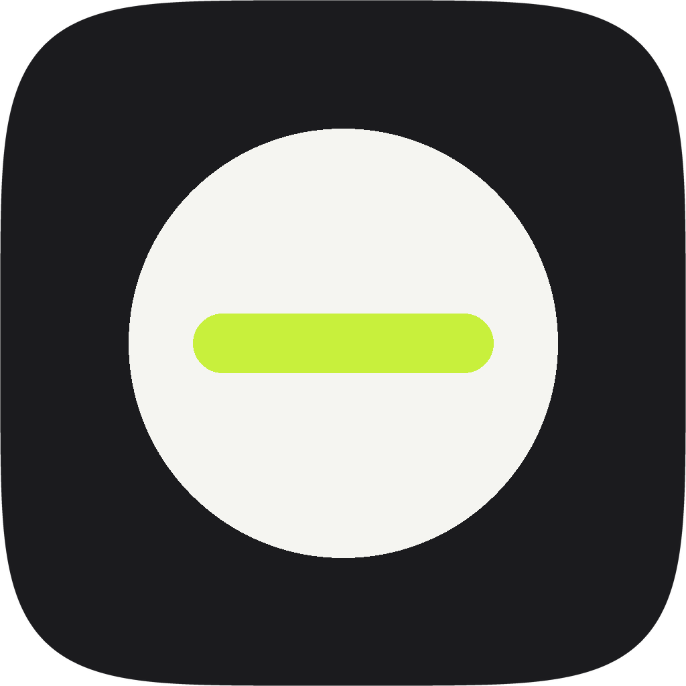
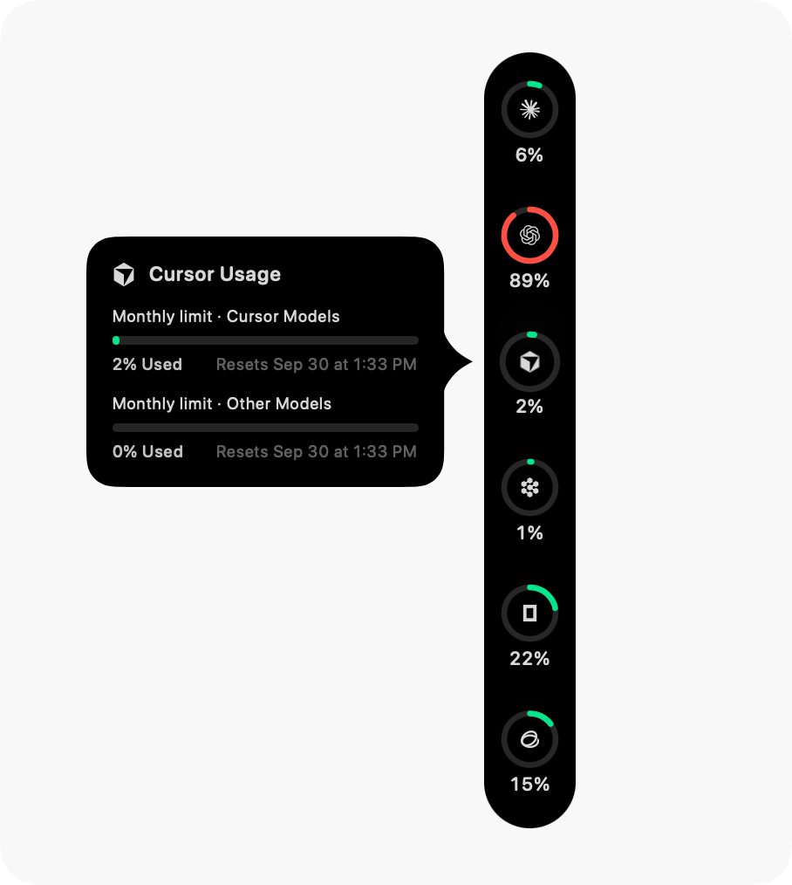

<p align="center">
  
</p>

<h1 align="center">Blinky</h1>

<p align="center">
  <b>Blinky</b> is Harris's macOS fork of <a href="https://github.com/qunqin24/Pulse">Pulse</a>, under the same name as his iOS app. This repository is not upstream Pulse.
</p>

<p align="center">
  <b>Know how much Claude Code, Codex and Cursor you have left — without opening a single usage page.</b><br>
  A free, open-source macOS monitor that sits on the edge of your screen and shows every AI coding limit at a glance.
</p>

<p align="center">
  <a href="https://github.com/harrisliangsu/blinky-mac/releases/latest"></a>
</p>

<p align="center">
  <a href="https://afdian.com/a/sharkchiligaga">Sponsor</a>
</p>

<p align="center">
  <a href="https://github.com/harrisliangsu/blinky-mac/releases/latest"></a>
  
  <a href="https://github.com/harrisliangsu/blinky-mac/actions/workflows/ci.yml"></a>
  
  <a href="LICENSE"></a>
  <a href="https://github.com/harrisliangsu/blinky-mac/stargazers"></a>
  <a href="https://github.com/harrisliangsu/blinky-mac/releases"></a>
  <a href="https://github.com/harrisliangsu/blinky-mac/issues"></a>
  <a href="https://github.com/harrisliangsu/blinky-mac/commits/main"></a>
</p>

<p align="center">
  <sub><b>macOS 14 Sonoma or newer</b> · Apple Silicon & Intel · <b>English</b> · <a href="README.zh-CN.md"><b>简体中文</b></a> · <a href="README.zh-Hant.md"><b>繁體中文</b></a> · <a href="README.ja.md"><b>日本語</b></a> · <a href="README.ko.md"><b>한국어</b></a></sub>
</p>

<p align="center">
  
  &nbsp;&nbsp;
  
</p>

- **Seventy-six services at a glance** — Claude Code, Codex, Cursor, GitHub Copilot, Antigravity, Kiro, Grok, DeepSeek, Kimi Code and many more, each as its own ring.
- **No Blinky account, no Blinky server** — it uses the logins you already have, and nothing is sent back.
- **Real numbers only** — every usage percentage is the one the service itself reported. The few estimates are marked as such, and where a service reports nothing, Blinky says so instead of guessing.
- **Native and quiet** — Swift and SwiftUI, Liquid Glass on macOS 26. Dock it left, right, along the top or along the bottom beside the Dock, let it fold to a sliver when idle, or keep it in the menu bar.

**Recently added:** usage in the menu bar with a dashboard for each account, starting usage windows after a reset, and animated bot marks. [What's new](https://github.com/harrisliangsu/blinky-mac/releases/latest).

<p align="center">
  
</p>

<p align="center">
  <sub>If Blinky has saved you from a surprise rate limit, a ⭐ helps other people find it.</sub>
</p>

---

## Installation

1. Download the latest **`Blinky-x.y.z.dmg`** from [Releases](https://github.com/harrisliangsu/blinky-mac/releases/latest).
2. Open the disk image and drag **Blinky** into your `Applications` folder. The file is `Blinky.app`. If `Pulse.app` is already there, move it to the Trash once Blinky is in place; an in-app update does not rename that older file.
3. On first launch, choose the services to monitor. All start unchecked; Blinky reads their credentials and checks usage only after you click **Done**. Closing the chooser leaves monitoring off; you can also enable a service in Settings. Upgrades keep your choices and ask once about newly supported services detected on your Mac.
4. Blinky lives in the menu bar. If your menu bar is crowded, right-click the floating rail — or the collapsed sliver — and choose **Settings…**; you can also assign a global shortcut for it under **Settings › General › Shortcuts**.

> [!NOTE]
> **macOS Gatekeeper First Launch**:<br>
> Blinky is an open-source project without an Apple Developer certificate. On first launch, macOS may block the app:
> - **Option 1 (GUI)**: Launch Blinky, dismiss the alert, open **System Settings → Privacy & Security**, and click **Open Anyway**.
> - **Option 2 (Terminal)**:
>   ```bash
>   xattr -cr /Applications/Blinky.app
>   ```
>   *Updates are offered in-app through Sparkle. macOS may request browser keychain access again after an update.*

---

## Key Features

### Rings at a glance
- **Colours that follow usage** — green through amber to red, or a colour of your own for each account.
- **Used or left** — `75% used` or `25% left`, with an optional clock arc for how much of the window has passed.
- **Live activity** — a turning dot while an agent is working, and optional animated bots that react to each account.

### Details when you point at a ring
- **Every limit and its reset** on one card, in continuous or segmented bars.
- **Detailed card** — the plan, when it was read, what each limit is worth, and recent usage from this Mac's records.
- **Burn-rate forecast** — tells you when your pace will run out before the window does.
- **In the menu bar** — the fullest ring as a figure, a small ring or split limits, with an optional dashboard.

<p align="center">
  
</p>

### Stays out of the way
- **Any edge** — left, right, top, beside the Dock, or anywhere at all; it folds to a sliver when idle.
- **Notifications you choose** — a limit crossing a line, spent, reset, failing checks, a low balance, a provider outage.
- **Six languages** — English, Simplified and Traditional Chinese, Japanese, Korean and Russian.
- **Optional extras** — global shortcuts, following the active display, hiding from screenshots.

### Spend, status and the rest
- **Token spend** — what 54 local clients have used, priced at public API rates, by day, model and agent, over any span you choose.
- **Estimates in your currency** — dollars, yuan, Hong Kong or New Taiwan dollars, yen, won or roubles.
- **Usage recaps** — shareable cards for a day, a week, a month or a year, built from the same records.
- **Service status** — 44 providers' own status pages, and a notification when one reports an outage.
- **Connection diagnostics** — where each figure came from, and the servers' own replies.
- **For power users** — several accounts per provider, extensions for your own sources, and `--json` for scripts.

<p align="center">
  
  &nbsp;&nbsp;
  
</p>

**Everything in detail:** [Docs/features.md](Docs/features.md).

**Also in this build:** ring colour schemes (Red alert, Gradient, Quiet); a Codex reset forecast and the latest reset on the card; ribbons when a weekly or monthly limit comes back; Kimi Code device-code sign-in and more than one account; Qoder with a personal token.

---

## Supported Providers & Data Routes

76 services, each read the way the product itself works — its own usage endpoint, the editor's login, a local language server, or a key you paste — and every percentage is the one the service reported. [The full list, and how each is read](Docs/supported-services.md).

---

## Privacy & Security

- **No Blinky account, no Blinky server** — your Mac talks to the services you use, under your own logins.
- **Five kinds of connection, all listed** — those services, their public status pages, [models.dev](https://models.dev) for model prices, [ExchangeRate-API](https://www.exchangerate-api.com) only when you pick a currency other than the dollar, and GitHub/Sparkle for updates.
- **Your keys stay on your Mac**, encrypted, and the usage records Blinky reads never leave it.

[In detail](Docs/features.md#privacy-and-security).

---

## Build from Source

Blinky is built with native Swift and SwiftUI. Building the current sources needs the full **Xcode** (not the Command Line Tools), including the **macOS 26 SDK**; the app runs on **macOS 14+**.

```bash
# Clone the repository
git clone https://github.com/harrisliangsu/blinky-mac.git
cd blinky-mac

# Build the app bundle
./Scripts/bundle.sh

# Launch it
open build.noindex/Blinky.app
```

`swift run Pulse` is a quick way to build and run without a bundle, but notifications and in-app updates only work from the bundled app. See [Docs/build-from-source.md](Docs/build-from-source.md) for toolchain setup. Shipping a release: [Docs/releasing.md](Docs/releasing.md).

---

## Contributing

How the repo is documented, what must not regress, and how to update the right page: [CONTRIBUTING.md](CONTRIBUTING.md). Map of topic docs: [Docs/README.md](Docs/README.md).

---

## Design Attribution

The interface comes from [Pulse](https://github.com/qunqin24/Pulse), which was inspired by a UI concept shared by [**Vinz** (@hivinz_)](https://x.com/hivinz_/status/2092996055248126353) on X in August 2026. Pulse is an independent implementation with its own interactions, functionality, animations, and visual details. Blinky for Mac is a fork of that project. Vinz is not affiliated with or responsible for Pulse or Blinky.

---

## Support the upstream author

<p align="center">
  <sub>Blinky for Mac is a fork of Pulse. The link below buys a coffee for the upstream author.</sub>
</p>

<p align="center">
  <a href="https://afdian.com/a/qunqin"></a>
</p>

---

## License

Licensed under [Apache 2.0](LICENSE). Bundled third-party assets retain their respective licenses; see [THIRD_PARTY_NOTICES.md](THIRD_PARTY_NOTICES.md).

---

## Star History

<a href="https://star-history.com/#harrisliangsu/blinky-mac&Date">
  <picture>
    <source media="(prefers-color-scheme: dark)" srcset="https://api.star-history.com/svg?repos=harrisliangsu/blinky-mac&type=Date&theme=dark" />
    <source media="(prefers-color-scheme: light)" srcset="https://api.star-history.com/svg?repos=harrisliangsu/blinky-mac&type=Date" />
    
  </picture>
</a>
